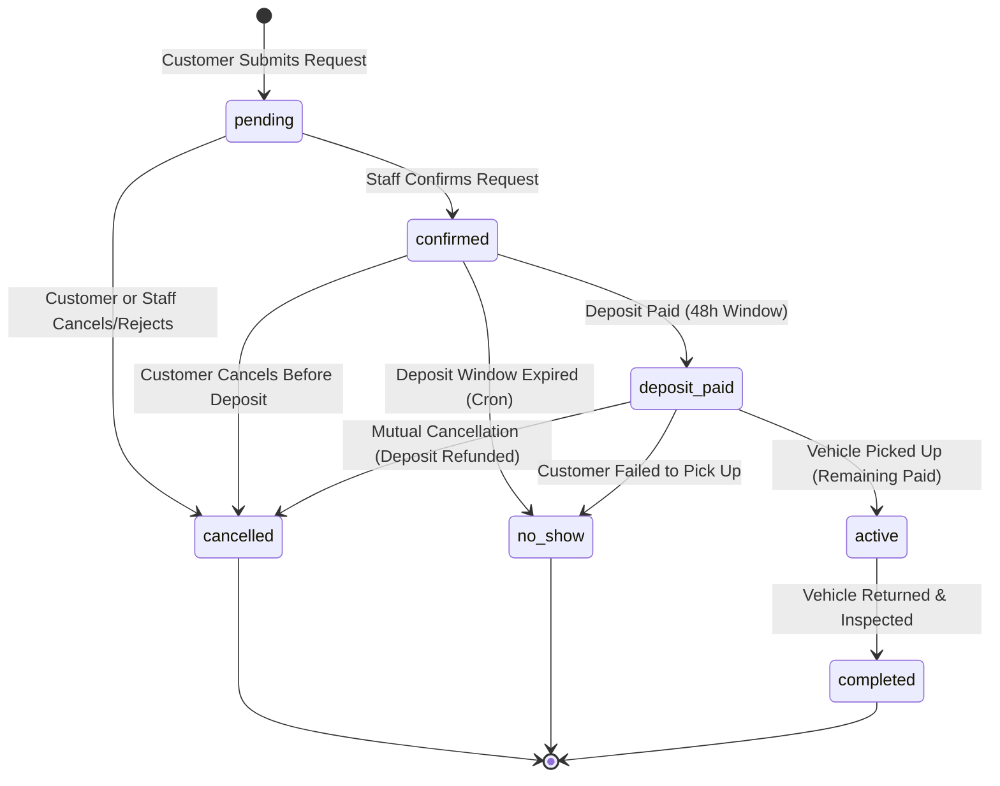

# Algeria Car Rental Platform (كراء السيارات الجزائر) — Project Overview

A full-stack, mobile-first, multilingual car rental web application designed specifically for the realities of the Algerian market.

---

## 1. Plain-Language Description

In Algeria, car rental businesses cannot rely solely on online card rails (like Stripe or PayPal) for upfront payments. Cash on delivery/pickup remains the dominant payment method, although Edahabia (Algérie Poste prepaid card) and CIB (interbank cards) are increasingly common for online transactions.

A rental car is a physical asset with high holding and idle opportunity costs: if a customer reserves a car and fails to show up, the dealership suffers direct financial losses.

This platform solves this challenge with an Algerian-tailored booking lifecycle:
1. **Browse & Request**: Customers browse available vehicles by category, transmission, branch, and seating capacity. They submit a booking request along with their driver's license details and photos without paying immediately.
2. **Review & Hold**: Dealership branch staff review the request, verify the driver's license and customer history (including no-show checks), and either confirm or reject the reservation.
3. **Deposit Hold**: Upon staff confirmation, the customer is notified and provided a 48-hour deposit window to pay a modest refundable deposit (e.g. 5,000 DZD) via Edahabia/CIB/BaridiMob.
4. **Pickup & Cash Settle**: At pickup, the customer inspects the vehicle condition with staff, signs the digital condition report, and pays the remaining rental balance in cash or card.

---

## 2. User Roles & Permissions

The system enforces strict role-based access control (RBAC) across 4 roles:

| Role | Permissions & Access Scope |
| :--- | :--- |
| **`customer`** | • Browse available vehicles and filter by city/agency.<br>• Submit reservation requests.<br>• View own reservations, timelines, and status updates.<br>• Cancel own pending or confirmed reservations.<br>• Upload and update driver's license document in private storage.<br>• Update personal profile and preferred language (Arabic, French, English). |
| **`staff`** | • Scoped to their assigned agency branch (`branch_id`).<br>• View incoming pending reservation requests for their branch.<br>• Review customer license documents.<br>• Confirm or reject reservations with staff notes.<br>• Manage branch vehicles (toggle available, maintenance, retired).<br>• Create and edit vehicles at their branch. |
| **`branch_manager`** | • All staff privileges.<br>• View branch performance and reports.<br>• Manage branch staff assignments. |
| **`admin`** | • System-wide access across all branches.<br>• Create and configure branches (address, wilaya, phone, coordinates).<br>• Create staff and manager accounts and assign them to branches.<br>• Access complete audit logs (`audit_log` table).<br>• View all reservations and override system states. |

---

## 3. Reservation State Machine



### State Definitions:
- **`pending`**: Customer submitted reservation dates, pickup/dropoff branches, and vehicle selection. No physical asset is strictly locked yet, but requested dates are under staff review.
- **`confirmed`**: Staff verified the request and approved it. The vehicle is blocked in PostgreSQL using GiST exclusion constraints (`prevent_double_booking`). The customer has a 48-hour deadline (`deposit_deadline`) to pay the refundable deposit.
- **`deposit_paid`**: Customer completed payment of the refundable deposit via Edahabia/CIB or confirmed receipt. Booking is secure.
- **`active`**: Customer arrived at the branch, conducted the walkaround inspection, paid the remaining balance (cash/card), and drove off.
- **`completed`**: Customer returned the vehicle, return condition inspection was completed, deposit was reconciled/refunded.
- **`cancelled`**: Request was cancelled by either party prior to pickup. The vehicle hold is released immediately.
- **`no_show`**: Customer failed to pay deposit within the 48h window or failed to pick up the vehicle. The customer's `no_show_count` increments in `profiles` to safeguard against serial ghost bookings.

---

## 4. Phase Breakdown

### Phase 1: Foundation (Current Implementation - 100% Complete)
- [x] Full database schema with 12 PostgreSQL tables in `supabase/init.sql`.
- [x] `btree_gist` extension and database-level double-booking prevention constraint (`prevent_double_booking`).
- [x] Row Level Security (RLS) policies on all 12 tables.
- [x] Multilingual Arabic (RTL primary), French (LTR), English (LTR) dictionary system with locale-switching.
- [x] Responsive, mobile-first design with Tailwind CSS v4 design tokens (`globals.css` with `@theme inline`).
- [x] Customer browsing with multi-parameter filtering (category, transmission, seats, agency branch).
- [x] Customer dashboard with reservation tracking, profile management, and driver's license upload.
- [x] Staff dashboard with pending request queue, confirm/reject review actions, and vehicle fleet CRUD.
- [x] Admin dashboard with overview metrics, branch management, staff onboarding, and global reservation table.
- [x] Comprehensive security definer audit logging for state transitions (`audit_log`).

### Phase 2: Real-time & Communications (Schema Ready)
- Table `notifications` with multilingual titles and messages.
- Real-time updates for reservation status changes via Supabase Realtime subscriptions.
- SMS / WhatsApp integration for booking confirmations and deposit payment reminders.

### Phase 3: Payments & Verification (Schema Ready)
- Table `payments` supporting Edahabia, CIB, BaridiMob, CCP, and Cash.
- Integration with SATIM / GIM-Mobile payment gateways for direct Edahabia/CIB processing.
- Automated 48-hour deposit expiration worker (`process_expired_deposits`).

### Phase 4: Fleet Operations & Condition Inspection (Schema Ready)
- Table `vehicle_condition_reports` capturing odometer readings, fuel levels (`empty` to `full`), damage flags, and vehicle inspection photos at pickup and return.
- Table `reviews` for verified customer ratings (1-5 stars) on completed rentals.

---

## 5. Architectural Decisions & Assumptions

1. **Database-Level Double Booking Guard**: Application logic alone cannot prevent race conditions when two customers attempt to book the same vehicle at the exact same moment. We enforce this at the database engine level via PostgreSQL `EXCLUDE USING gist (vehicle_id WITH =, date_range WITH &&) WHERE (status IN ('confirmed', 'deposit_paid', 'active'))`.
2. **Private Document Storage**: Driver's licenses and national ID scans contain sensitive personally identifiable information (PII). Files are stored in a private Supabase Storage bucket (`documents`) and accessed via authenticated signed URLs or staff role permissions — never made publicly accessible.
3. **Arabic-First RTL Architecture**: Arabic is the official language and primary consumer interface in Algeria, followed by French in commercial business. The application sets `dir="rtl"` on `<html>` for Arabic and `dir="ltr"` for French/English, using CSS logical properties (`start`, `end`, `ms-*`, `me-*`) throughout.
4. **Tailwind CSS v4 `@theme inline`**: In Tailwind CSS v4, configuration is CSS-first. We defined our color palette (brand navy, amber/gold accent, teal success, danger red, and neutral gray ramp) directly within `app/globals.css`.
5. **Next.js 16 Server Actions & Forms**: Form submissions use React 19's `useActionState` and Server Actions with Zod schemas (`lib/validations/`) for type-safe server-side validation.

---

## 6. Directory Structure

```
car_rental/
├── app/
│   ├── [lang]/
│   │   ├── (auth)/
│   │   │   ├── callback/route.ts       # Supabase OAuth/code exchange
│   │   │   ├── login/                  # Customer & staff login
│   │   │   ├── signup/                 # New customer registration
│   │   │   └── layout.tsx              # Auth gradient layout
│   │   ├── admin/                      # Admin dashboard
│   │   │   ├── branches/               # Agency branch management
│   │   │   ├── reservations/           # Global reservation table
│   │   │   ├── staff/                  # Staff account creation & roles
│   │   │   ├── layout.tsx              # Admin sidebar layout
│   │   │   └── page.tsx                # Admin overview metrics
│   │   ├── dashboard/                  # Customer portal
│   │   │   ├── profile/                # Profile & license upload
│   │   │   ├── reservations/           # Customer reservations & cancel
│   │   │   ├── layout.tsx              # Customer navigation layout
│   │   │   └── page.tsx                # Customer overview & stats
│   │   ├── staff/                      # Branch staff dashboard
│   │   │   ├── reservations/[id]/      # Confirm / reject review interface
│   │   │   ├── vehicles/               # Vehicle fleet CRUD & status toggle
│   │   │   ├── layout.tsx              # Staff sidebar layout
│   │   │   └── page.tsx                # Pending requests queue
│   │   ├── vehicles/                   # Public fleet catalog
│   │   │   ├── [id]/                   # Vehicle details & booking form
│   │   │   └── page.tsx                # Filterable vehicle catalog
│   │   ├── dictionaries.ts             # Dynamic dictionary loader
│   │   ├── layout.tsx                  # Multilingual RTL/LTR HTML shell
│   │   └── page.tsx                    # Homepage (Hero, Steps, Featured)
│   ├── globals.css                     # Tailwind v4 @theme inline tokens
│   └── layout.tsx                      # Root Next.js layout wrapper
├── components/
│   ├── dashboard/                      # Dashboard UI (tables, stats, forms)
│   ├── layout/                         # Header, Footer, LanguageSwitcher
│   ├── reservations/                   # Booking form, timeline, status badges
│   ├── ui/                             # Buttons, inputs, modals, badges, cards
│   └── vehicles/                       # Vehicle cards, filters, gallery
├── dictionaries/
│   ├── ar.json                         # Arabic translations (RTL primary)
│   ├── en.json                         # English translations
│   └── fr.json                         # French translations
├── lib/
│   ├── actions/                        # Server Actions (auth, reservations, vehicles)
│   ├── supabase/                       # Supabase client, server, admin helpers
│   ├── utils/                          # Constants, currency formatting, dates
│   └── validations/                    # Zod validation schemas
├── supabase/
│   └── init.sql                        # Complete PostgreSQL database schema
├── types/
│   ├── database.ts                     # TypeScript database types
│   └── index.ts                        # Barrel export & Dictionary type
├── proxy.ts                            # Next.js 16 proxy (auth & locale redirects)
└── PROJECT_OVERVIEW.md                 # System documentation & state machine
```
